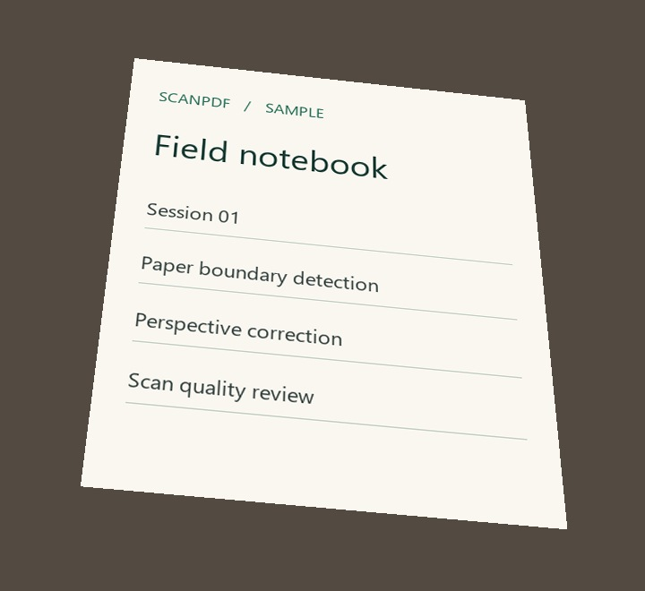
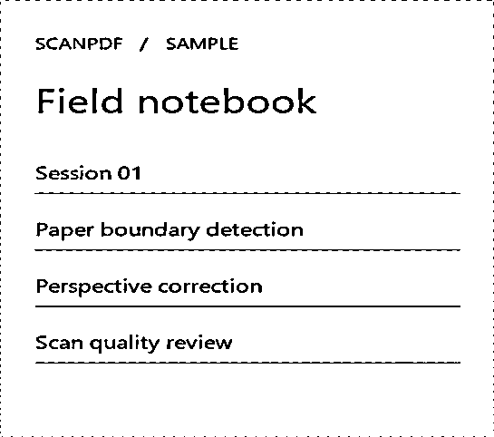

# ScanPDF

Turn phone photos into a straightened, cleaned, multi-page PDF that fits an upload limit. ScanPDF runs locally using Tkinter and classic OpenCV.

| Angled input | ScanPDF output · Black & white |
| --- | --- |
|  |  |

## Run from source

From the project folder, using Python 3.10 or newer:

```bash
python -m pip install -e .
python -m scanpdf
```

Windows users can also double-click **ScanPDF.pyw** after installation.

## Scan and export

1. **Add photos** opens the file picker. Select multiple photos with Ctrl or Shift. Use **Up** and **Down** to set PDF page order.
2. Select a thumbnail. Drag the four handles to the paper edges. If detection fails, the handles start at the image boundaries.
3. Choose a **Finish** for the page: original color, grayscale, black & white, or color boost. **Preview** shows the flattened page. **Corners** returns to editing.
4. Enter a **Size limit (MB)** and click **Export PDF**. The default is 2 MB (2,000,000 bytes). Clear the field for unrestricted export. **Save image** exports only the selected page.

Compression measures the finished PDF after each attempt. It reduces JPEG quality from 92 to 35 first, then reduces page dimensions down to 25%. The export dialog reports the actual bytes, quality and scale. An unreachable limit leaves any existing output intact.

**Merge PDFs** joins existing files in the order you choose. **Split PDF** extracts a page or an inclusive range such as 2-5. Ctrl+O adds photos and Ctrl+E exports your stack.

## Build the Windows desktop app

Run on Windows from the project folder:

```bash
python -m pip install -e ".[build]"
python -m PyInstaller --clean --noconfirm ScanPDF.spec
```

Launch **dist/ScanPDF/ScanPDF.exe**. To share the app, distribute the entire **dist/ScanPDF** folder, including **_internal**. Recipients can extract the folder and launch the executable without installing Python.

## Tests and continuous integration

```bash
python -m pip install -e ".[dev]"
python -m pytest -q
```

The GitHub Actions workflow tests Python 3.10 and 3.13 on Windows. After both pass, it builds the desktop app and checks that the packaged window opens. Download **ScanPDF-Windows-x64** from the successful workflow run's artifacts.

## Project layout

- **scanpdf/core/** — geometry, enhancement, PDF editing, and size-limited export
- **scanpdf/gui/** — Tkinter workspace, page controls, and corner editor
- **samples/** — simulated document photos, flat reference pages, and export examples
- **tests/** — geometry, corner mapping, enhancement, PDF structure, and compression tests
